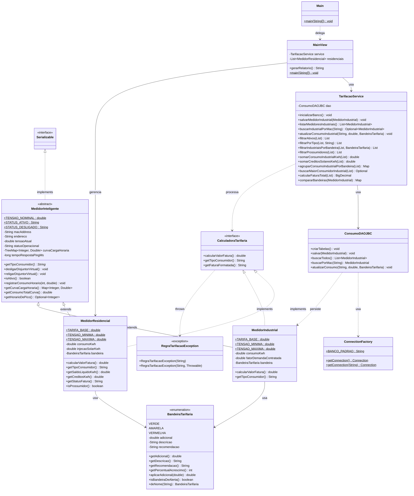

# ⚡ Sistema Smart Grid & EcoTarifa

<div align="center">

  
  
  
  

</div>

<br>

**Autores:**
Henrique Gabriel Barbosa Guida Rodrigues,
Guilherme Meira de Melo,
Lara Antonia Marques Oliveira,
Philipy Dekam Silva de Oliveira,
Vinícius Soares de Melo,
Jeanderson Honorato de Souza

**Disciplina:** Linguagem de Programação II

---

## 📌 Sobre o Projeto

O **Sistema Smart Grid & EcoTarifa** é uma solução computacional orientada a objetos desenvolvida em **Java 25** para simulação, monitoramento e gerenciamento inteligente de distribuição de energia elétrica em redes inteligentes (*Smart Grids*).

O sistema integra **telemetria bidirecional** de medidores inteligentes (*Smart Meters*), **microgeração distribuída (energia solar fotovoltaica)** com compensação de créditos (*Net Metering*), **bandeiras tarifárias dinâmicas**, **persistência relacional com H2 em memória via JDBC**, **análises consolidadas com Java Streams API** e uma **interface gráfica em Java Swing** (com suporte adicional ao **modo console** via `--console`).

---

## 🚀 Funcionalidades Principais

- 📡 **Telemetria de Medição Inteligente (`MedidorInteligente`):**
  - Identificação unívoca de cada medidor por endereço físico (`MAC Address`, formato `AA:BB:CC:DD:EE:FF`).
  - Registro de **curva de carga horária** (24 horas) com identificação automática do horário de pico.
  - Serialização com `Serializable` e latência de comunicação (`tempoRespostaPingMs`) marcada como `transient`.

- 🛡️ **Segurança e Proteção da Rede Elétrica:**
  - Monitoramento contínuo da tensão elétrica (faixa segura de `198 V` a `242 V`, nominal `220 V`).
  - **Disjuntor virtual** com acionamento de corte (`ATIVO` / `DESLIGADO`) e bloqueio automático do faturamento via `RegraTarifacaoException`.

- 🏠 **Medidores Residenciais & Prossumidores (`MedidorResidencial`):**
  - Cálculo sobre o saldo energético líquido: `Saldo Líquido = Consumo Ativo - Injeção Solar`.
  - Suporte completo ao perfil de **prossumidor** (*Net Metering*): geração de créditos em kWh quando a injeção solar supera o consumo, com detecção automática de status (`A PAGAR`, `ZERADA` ou `CRÉDITO`).

- 🏭 **Medidores Industriais & Fator de Demanda (`MedidorIndustrial`):**
  - Faturamento com tarifa base industrial, adicional de **Bandeira Tarifária** (`VERDE` ×1,0 | `AMARELA` ×1,2 | `VERMELHA` ×1,5) e **fator de demanda contratada**.
  - Simulação comparativa de fatura entre todas as bandeiras com recomendações de consumo.

- 🗄️ **Persistência de Dados (DAO + JDBC + H2):**
  - Banco de dados relacional **H2 em memória** gerenciado por `ConnectionFactory` (com validação de nome de banco e `DB_CLOSE_DELAY=-1`).
  - Camada `ConsumoDAOJBC` com criação automática de tabelas (`medidor` e `medidor_industrial`), `PreparedStatement` contra SQL Injection e controle manual de transações (`commit` / `rollback`).

- 📊 **Análises com Streams API (`TarifacaoService`):**
  - Filtros por status operacional, tipo de consumidor, bandeira tarifária e perfil prossumidor.
  - Agregações de consumo industrial, agrupamento de consumo por bandeira, busca de maior consumidor, soma de créditos solares e faturamento polimórfico consolidado com `BigDecimal`.

- 🖥️ **Interface Gráfica Swing + Modo Console (`MainView`):**
  - Cartões de resumo em tempo real, tabelas ordenáveis com destaque colorido de status/bandeiras, cadastro/atualização no H2, gráfico ASCII da curva de carga horária e relatório consolidado.
  - Executável independente (`.jar` com H2 embutido + `executar.bat`) com opção `--console`.

---

## 🏛️ Arquitetura e Modelagem OO

O projeto aplica os pilares da **Programação Orientada a Objetos (POO)** e organização em camadas:

- **Herança e Polimorfismo:** `MedidorInteligente` (abstrata) é estendida por `MedidorResidencial` e `MedidorIndustrial`, que implementam o contrato polimórfico `CalculadoraTarifaria`.
- **Encapsulamento e Exceções Verificadas:** validações de consumo negativo, fator de demanda inválido, tensão fora da faixa segura e disjuntor desligado lançam a exceção checked `RegraTarifacaoException`.
- **Separação em Camadas:** pacotes distintos para `model`, `exception`, `dao`, `controller` e `view`.
- **Documentação Javadoc:** todas as classes e métodos públicos documentados e prontos para geração com `mvn javadoc:javadoc`.

---

## 🔗 Diagrama de Classes (UML)



---

## 📂 Estrutura de Diretórios

```text
sistema-smart-grid/
├── README.md                                          # Documentação principal do repositório
└── sistema-smart-grid-ecotarifa/                      # Módulo do projeto Java com Maven
    ├── pom.xml                                        # Maven + H2 + Shade (JAR executável) + Javadoc
    ├── executar.bat                                   # Atalho executável para Windows (GUI / --console)
    ├── dist/
    │   └── smart-grid-ecotarifa.jar                   # JAR executável pronto (com H2 embutido)
    └── src/
        └── main/
            ├── java/br/edu/ifgoiano/smartgrid/
            │   ├── controller/
            │   │   └── TarifacaoService.java          # Streams API, filtros e regras de negócio (Guilherme) ✅
            │   ├── dao/
            │   │   ├── ConnectionFactory.java         # Fábrica de conexões JDBC/H2 (Vinícius) ✅
            │   │   └── ConsumoDAOJBC.java             # DDL (Vinícius) + CRUD transacional (Henrique Gabriel) ✅
            │   ├── exception/
            │   │   └── RegraTarifacaoException.java   # Exceção verificada de tarifação (Philipy) ✅
            │   ├── model/
            │   │   ├── BandeiraTarifaria.java         # Enum de bandeiras tarifárias (Lara) ✅
            │   │   ├── CalculadoraTarifaria.java      # Interface polimórfica de fatura (Philipy) ✅
            │   │   ├── MedidorInteligente.java        # Superclasse abstrata dos medidores (Lara) ✅
            │   │   ├── MedidorIndustrial.java         # Medidor industrial (Philipy) ✅
            │   │   └── MedidorResidencial.java        # Medidor residencial / Prossumidor solar (Philipy) ✅
            │   └── view/
            │       ├── MainView.java                  # Interface Swing + Modo console (Jeanderson) ✅
            │       └── Main.java                      # Classe auxiliar de entrada (Jeanderson) ✅
            └── resources/
                └── .gitkeep
```

---

## 👥 Divisão de Responsabilidades

| # | Membro | Papel | Arquivos sob responsabilidade | Status |
| :---: | :--- | :--- | :--- | :---: |
| 1 | **Lara Antonia Marques Oliveira** | Arquiteta de Domínio | `model/MedidorInteligente.java`, `model/BandeiraTarifaria.java` | 🟢 Concluído |
| 2 | **Philipy Dekam Silva de Oliveira** | Especialista em Polimorfismo | `model/CalculadoraTarifaria.java`, `model/MedidorResidencial.java`, `model/MedidorIndustrial.java`, `exception/RegraTarifacaoException.java` | 🟢 Concluído |
| 3 | **Vinícius Soares de Melo** | Engenheiro H2 | `dao/ConnectionFactory.java`, método `criarTabelas()` em `ConsumoDAOJBC` | 🟢 Concluído |
| 4 | **Henrique Gabriel Barbosa Guida Rodrigues** | Desenvolvedor JDBC | Métodos `salvar()`, `buscarTodos()`, `buscarPorMac()` e `atualizarConsumo()` em `ConsumoDAOJBC` | 🟢 Concluído |
| 5 | **Guilherme Meira de Melo** | Mago das Streams API | `controller/TarifacaoService.java` (filtros, somas, agrupamentos e comparativos) | 🟢 Concluído |
| 6 | **Jeanderson Honorato de Souza** | Tech Lead / Integrador | `view/MainView.java`, `view/Main.java` e revisão de Javadoc | 🟢 Concluído |

---

## 🛠️ Tecnologias e Ferramentas

| Tecnologia | Finalidade |
| :--- | :--- |
| **Java 25** | Linguagem principal, Streams API, Serialização e interface gráfica Swing |
| **Apache Maven** | Build, gerenciamento de dependências, empacotamento (`maven-shade-plugin`) e Javadoc |
| **H2 Database 2.5.252** | Banco de dados relacional em memória via JDBC |
| **Git & GitHub** | Controle de versionamento e colaboração da equipe |
| **VS Code / IntelliJ IDEA** | Ambientes de Desenvolvimento Integrado (IDE) |

---

## ⚙️ Pré-requisitos

- **Java Development Kit (JDK):** Versão 25 (ou superior).
- **Apache Maven:** Versão 3.8 ou superior (apenas para recompilar; para rodar o `.jar` pronto basta o Java).

```bash
java -version
mvn -version
```

---

## 💻 Como Compilar e Executar

### 1. Clonar o Repositório
```bash
git clone git@github.com:HGBGR2003/sistema-smart-grid.git
cd sistema-smart-grid/sistema-smart-grid-ecotarifa
```

### 2. Executar o JAR Pronto (mais rápido)
* **Interface Gráfica (Swing):**
  ```bash
  java -jar dist/smart-grid-ecotarifa.jar
  ```
  *(No Windows, você também pode abrir diretamente o arquivo `executar.bat`.)*

* **Modo Console:**
  ```bash
  java -jar dist/smart-grid-ecotarifa.jar --console
  ```

### 3. Compilar e Empacotar com o Maven (opcional)
```bash
mvn clean package
```

### 4. Gerar Documentação Javadoc
```bash
mvn javadoc:javadoc
```

---

## 📜 Licença

Este projeto foi desenvolvido para fins exclusivamente acadêmicos e pedagógicos no âmbito da disciplina de **Linguagem de Programação II**.
